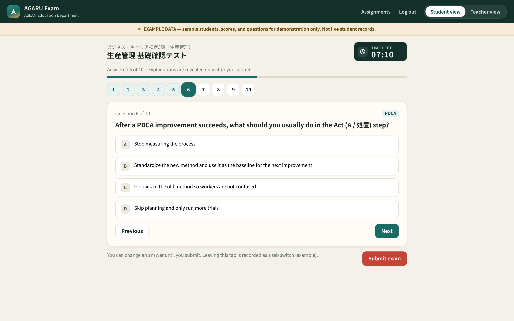
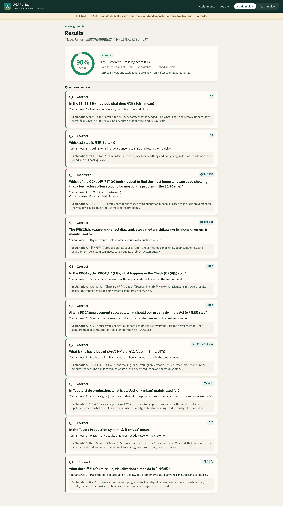
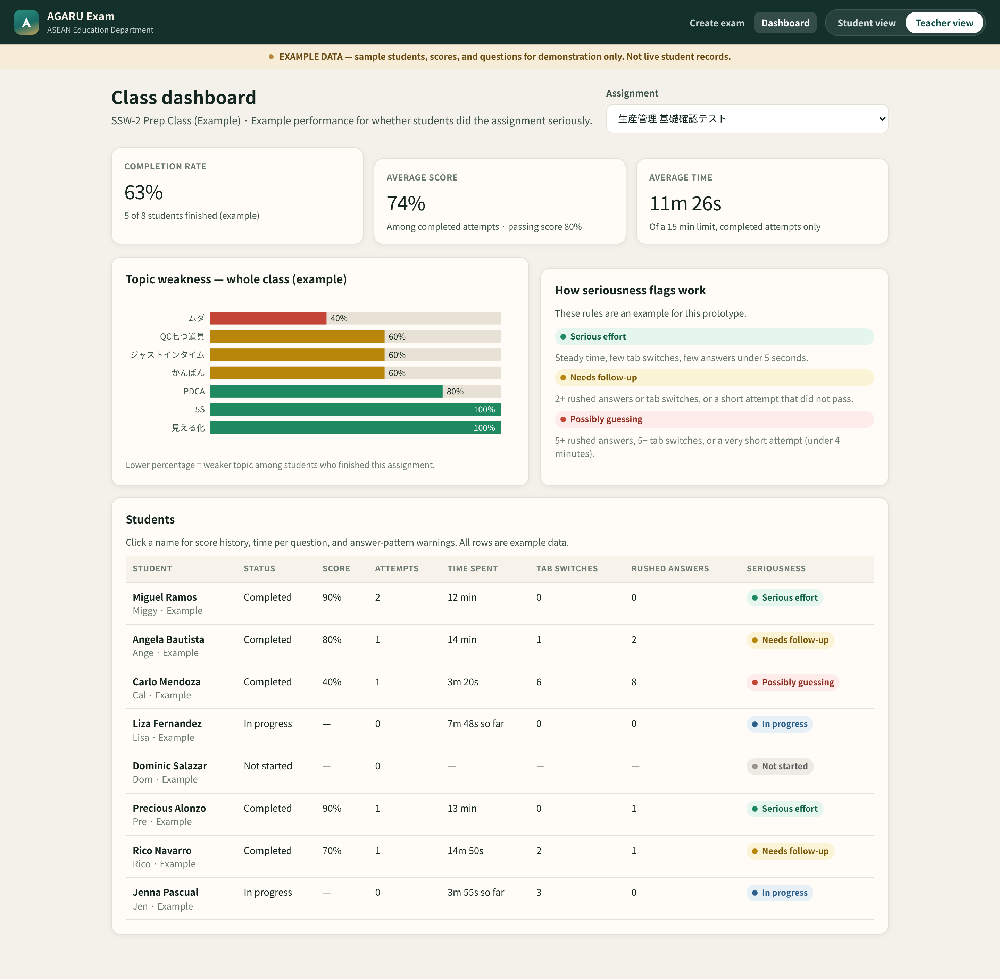

# AGARU Exam

A front-end prototype of a timed exam app for **AGARU Exam**, built for the ASEAN Education Department (株式会社アセアン).

This is a clickable mockup only. All students, scores, and exam results are **example data** and are not saved. Nothing is connected to a real login or database yet.

## Try it

Open the [live demo](https://jun-ejercito.github.io/agaru-exam-mockup/) in any browser, or open `index.html` locally.

- Use the switch at the top to move between the **student** and **teacher** views.
- On the student side, pick any example student and type anything as the password.
- You can also upload a CSV of questions and press **Generate exam**. The new exam appears in the student's assignment list.

## Screenshots

### Taking an exam

The exam view includes a countdown timer. Answers stay hidden until every question is submitted.

### Results

After submitting, the student sees their score together with the correct answers and explanations.

### Teacher dashboard

The teacher view shows class performance and seriousness flags, such as time spent, completion, and answer patterns.

## Files

- `index.html` — the full prototype (student exam, results, and teacher dashboard)
- `exam-taking.png`, `results.png`, `teacher-dashboard.png` — screenshots of the three main screens
